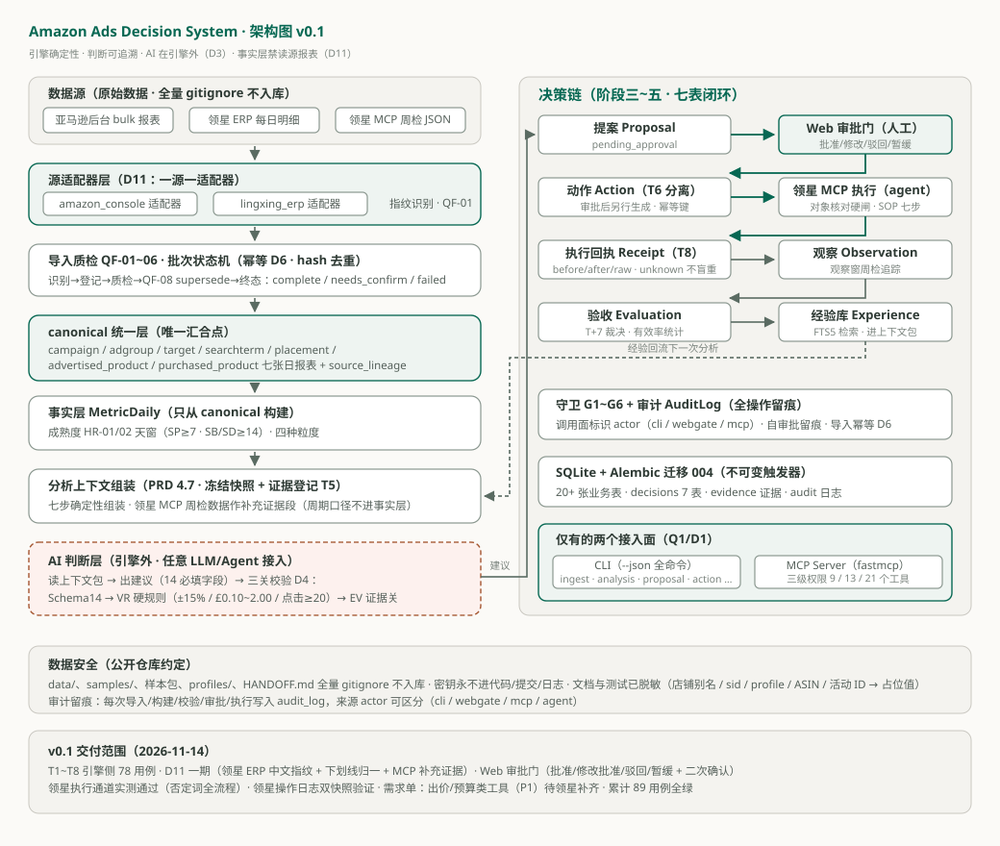

# Amazon Ads Decision System（亚马逊广告智能优化与决策系统）

版本 **v0.11** ｜ Python 3.12 ｜ SQLite + Alembic ｜ 测试 135 用例全绿

一套**引擎确定性、判断可追溯**的亚马逊广告决策链系统：数据采集 → 统一层 → 事实层 → 分析上下文 → AI 建议 → 三关校验 → 人工审批 → 执行回执 → 观察验收 → 经验沉淀。AI 只出建议，引擎管事实与护栏，**每一笔改动都可从建议追溯到执行回执**。



## 架构要点

- **三段管道（D11 决议）**：源报表 → 源适配器 → canonical 统一层 → 事实层。事实层禁止读源报表；新增数据源只写适配器，下游零改动。当前适配器：`amazon_console`（后台 bulk 报表）、`lingxing_erp`（领星中文周报）、`lingxing_mcp_json`（领星 MCP JSON 响应，D11 二期：仅日粒度行，窗口聚合 JSON 明确拒绝——PRD 红线不虚构日期）。
- **AI 在引擎外（D3）**：`ads_core` 零 LLM 依赖。引擎只做确定性计算（成熟度、口径、质检、护栏），AI 通过冻结的**分析上下文包**读取事实并产出建议。
- **建议三关校验（D4）**：Schema14 必填字段 → VR-01~06 硬规则（未成熟行转化指标按显式 `metrics_referenced` 判定、缺失按安全原则拒绝；调价幅度 ±15% 与出价上下沿 £0.10~2.00 对齐 HR-08/09 例外语义——超限须附 `exception_justification`，步长例外还须 `exception_rollback_plan`；点击样本 ≥20、干扰事件引用）→ EV-01/02 证据存在性。不过关的建议进不了提案表。
- **审批与执行分离（T6）**：Web 审批门（`webgate/`，本机 127.0.0.1:8765）人工四决策（批准/修改批准/驳回/暂缓）；批准后另行生成动作，由 AI 会话经领星 MCP 执行并回执，执行前有对象核对硬闸。审批行记录 `approval_channel` + `identity_verified`：**已验证人工审批仅来自本机审批门（webgate）**；CLI/MCP 提交的审批一律标记未验证（`decided_by` 为自报姓名，系统无身份认证能力，不作为人工审批凭证）。
- **两个接入面（Q1/D1）**：CLI（`--json`）与 MCP Server（三级权限 9/13/21 个工具，物理不注册=最硬边界）。`read`/`analysis` 级拿不到审批、动作创建、回执、回滚等任何写工具；`data` 级为本地受限操作面（仅受信本机流程）。
- **回滚语义（P1-03）**：`action_rollback` 为**记录层回滚**——仅推进本地动作状态并留痕，不向亚马逊后台发送任何反向操作，不代表广告原始状态已恢复；外部恢复须另行人工操作并经回执核验。
- **质检体系（QF-01~10）**：报表类型指纹识别（含中文变体映射）、必要列/日期/数值/重复业务键/口径一致、跨批 QF-07（同源 warn）/QF-09（跨源 error）。

## 目录

```
ads_core/      引擎包：ingest（识别/导入）→ adapters（源适配器）→ canonical → facts（成熟度/口径）
               analysis（上下文组装/三关校验）→ decision（提案/审批/动作/回执/观察/验收）
               experience（经验库 FTS5）+ methodology（版本化规则源）+ mcp_server
webgate/       审批门 Web 页（Starlette + 原生 JS 单页，纯展示层零 SQL）
docs/          各阶段设计稿、交付文档、验收清单、执行 SOP、领星工具需求单
methodology/   已发布规则源 v1.0.0（19 条硬规则 HR-01~19 + 参数组）
scripts/       样本登记、开发库重建、批量导入等运维脚本
```

## 快速开始

```bash
cd ads_core
python -m venv .venv && .venv/Scripts/pip install -e ".[dev]"   # Windows
.venv/Scripts/ads init                                          # 建库 + 迁移
.venv/Scripts/ads methodology import ../methodology/v1.0.0.yaml # 导入规则源
.venv/Scripts/ads ingest <报表文件> --source-system amazon_console
.venv/Scripts/ads canonical build <batch_id>
.venv/Scripts/ads facts build --date-from 2026-10-01 --date-to 2026-10-31
.venv/Scripts/ads analysis context --sku <SKU> --date-from ... --date-to ...
.venv/Scripts/ads analysis validate <run_id> --file 建议.json   # 三关校验
.venv/Scripts/ads proposal submit <run_id>                      # 迁入提案（pending_approval）
```

审批门：双击 `审批门.bat`（或 `python webgate/app.py`），浏览器自动打开 `http://127.0.0.1:8765`。

MCP 接入：`ads mcp serve --permissions read,analysis`（三级 read/analysis/data，工具物理不注册）。

运行测试：`cd ads_core && .venv/Scripts/python -m pytest tests/ -q`（135 用例）。

## 数据与隐私

- **真实经营数据不入库**：`data/`、`samples/`、样本包目录全量 gitignore，密钥永不进代码/提交/日志。
- 仓库内文档与测试已脱敏：真实店铺别名、领星 sid/profile、ASIN、活动 ID 均替换为占位值（`B0TEST****`、`TESTNGT-*`、`111111…`）。
- 产品档案（profiles/）含经营细节，仅存本地不入库。

## 版本

- **v0.11**（2026-11-15）：D11 二期——领星 MCP JSON 适配器（`lingxing_mcp_json`）：按日拉取的 MCP 响应 JSON 直接入库（reader 支持 json + 指纹变体 + QF-02/_data_dates 校准 + MCP source_system 参数）；窗口聚合 JSON 显式拒绝（PRD 红线不虚构日期）；真实存档 e2e 与 CSV 路径锚点零差异；新增 10 项测试，累计 135 用例。详见 `docs/d11-2-json-adapter.md`。
- **fix/decision-defects-20261114**（2026-11-14）：缺陷修复——P0-01 观察窗 SKU 数据隔离（product_id 归属过滤 + 归属不明标注，多 SKU 动作须逐 SKU 拆分）、P0-02 同期动作识别（窗口 [start,end] 边界 + executed 状态闸门）、P1-01 指标引用显式声明（metrics_referenced，出价三值 current_bid/target_bid/adjustment_pct 拆分）、P1-02 HR-08/09 与 YAML 例外语义对齐（不改已发布 v1.0.0 业务含义）、P1-03 审批身份标记（005 迁移：approval_channel/identity_verified）与记录层回滚语义；新增 36 项测试 + 6978/6979 真实数据验证。详见 `docs/defect-fix-20261114.md`。
- **v0.1**（2026-11-14）：五阶段引擎交付——T1~T8 引擎侧 78 用例 + D11 一期（领星 ERP 适配 / MCP 补充证据）+ Web 审批门 + 领星执行通道实测通过，累计 89 用例。
